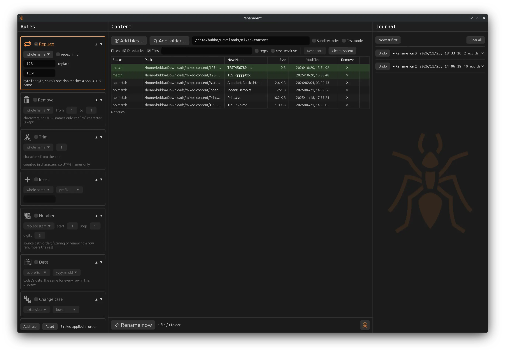

# renameAnt

Linux bulk rename utility: fast and safe renaming of files and directories, with selectable rules, preview and undo journal.



## Features

- **Rules**: default and custom rules
- **Preview**: before/after per row; conflicts, taken names and invalid names are reported before anything is written.
- **Safety**: dry run until confirmed, never overwrites an existing name, cycles and case-only renames staged through a temp name.
- **Undo**: append-only journal; reverse any run or one row of it, partial runs included. Runs older than 60 days are pruned at startup; the newest run is always kept.
- **Files**: folders or single files, optional subdirectories, kind and name filters, column sort, non-UTF-8 names kept as bytes.
- **Speed**: fast mode defers size and modified reads and batches journal syncs.
- **Logs**: the level is set in About; lines append to `renameant.log` beside the journal.

### Default Rules

- replace (regex toggle, optional full-path regex)
- remove (n chars from position x to y)
- trim (n chars from the end)
- insert (prefix, suffix, position)
- number (prefix, suffix, length)
- date (prefix, suffix, format (yyyymmdd, ddmmyyyy, mmddyyyy, yyyymmdd-hhmmss))
- change case (upper, lower, title, kebab, camel, pascal, snake, etc.)
- normalize (NFC, trim, collapse spaces, underscores, strip control characters, transliterate to ASCII)

## Install

[Download the latest release](https://github.com/dcog989/renameAnt/releases/latest):

| Platform                 | Format     | Install                                                               |
| ------------------------ | ---------- | --------------------------------------------------------------------- |
| Arch / CachyOS           | `.tar.zst` | `tar --zstd -xf renameant-*.tar.zst && sudo ./renameant-*/install.sh` |
| Debian / Ubuntu          | `.deb`     | `sudo apt install ./renameant_*.deb`                                  |
| Fedora / RHEL / openSUSE | `.rpm`     | `sudo dnf install ./renameant-*.rpm`                                  |
| Linux                    | AppImage   | `chmod +x renameAnt-*.AppImage && ./renameAnt-*.AppImage`             |

> [!NOTE]
> The `.deb`, `.rpm` and tarball install `renameant-gui` to `/usr/bin` with a menu entry and icon. The AppImage adds itself to the application menu, installs its icon, and repoints the entry when you move or rename it.

## GUI

- **Add Folders / Files…** picks what to rename; the rows a picked path contributes are listed, and a row can be removed. A folder contributes its children, a file only itself.
- **Subdirectories** scans the whole tree instead of one directory's children. Renames run bottom-up, so a child still has a valid path when its parent is renamed.
- **Filter** includes only the kinds you tick — directories, files (a symlink counts as a file) — and optionally a name pattern, plain text or regex. The pattern ignores case unless **case sensitive** is ticked. Filtered-out names stay taken.
- Click a header — Status, Path, New Name, Size or Modified — to sort by that column, and click it again to reverse. **Reset sort** puts the rows back to the order Apply runs them in.
- **Remove** (✕ or the row menu) takes a row out of the preview and the apply count; the file stays where it is. Removing or filtering a row renumbers a Number rule. The removal lasts until that path leaves the picked tree.
- **Fast mode** skips reading sizes and modification times until you sort by Size or Modified, and batches the journal's sync instead of writing one per rename. A crash mid-run can then leave the last renames of that run without an undo record; the renames themselves are unaffected.
- **Apply** performs the previewed plan; undo lives in the same panel.
- **Journal** lists past runs newest or oldest first; **✕** removes one run and **Clear all** empties it. That deletes undo records only — the files stay where they are.

## Technical

### Requirements

Rust 1.100+, `just`, `rsvg-convert`, `curl` and `zstd`. Building the packages also needs `cargo-deb` and `cargo-generate-rpm`.

Releases and the git hooks need `cog` (cocogitto), `cargo-edit` (`cargo set-version`) and `lefthook`:

```sh
cargo install cocogitto cargo-edit
lefthook install   # commit-msg, pre-commit and pre-push hooks
```

### Build

```sh
just                # verify the repo: clippy, formatting check and tests
just build          # target/release/renameant-gui
just check          # lint, format check and tests, as CI runs them
just install        # release build into ~/.local (binary, menu entry, icon)
just package        # AppImage, .deb, .rpm and .tar.zst into dist/out and target/
just release        # bump from conventional commits, write the changelog, tag and push
just run            # debug build and run of the GUI
just update         # refresh dependencies to the latest allowed versions
```

## License

[GNU GPL v3](LICENSE)
